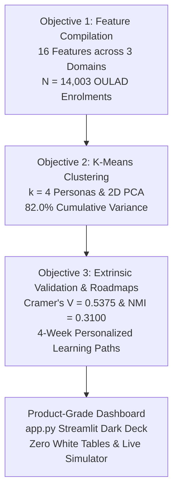

# EduCluster ML: K-Means Clustering of Student Engagement and Performance Data for Personalized Learning Path Design

**Candidate:** Parasa Bhavyaswi (Registration No: 12502256)  
**Supervisor:** Dr. Bhupinder Singh  
**Affiliation:** School of Computer Science & Engineering, Lovely Professional University, Phagwara, Punjab, India  

---

## 📌 Executive Summary

Modern virtual learning environments (VLEs) collect extensive digital engagement telemetry, yet educational institutions often struggle to convert raw clickstream logs into proactive academic interventions. **EduCluster ML** is an end-to-end unsupervised learning system that ingests **14,003 valid student-course enrolments** from the public Open University Learning Analytics Dataset (OULAD), engineers a balanced 16-feature representation across platform interaction, temporal consistency, and summative performance, and segments learners into four actionable pedagogical personas using K-Means clustering ($k = 4$).

Extrinsic statistical validation against unobserved course completion outcomes (`final_result`) confirms substantial non-random alignment without target leakage ($\chi^2 = 12,136.24$, $p < 0.0001$, Cramér's $V = 0.5375$, $\text{NMI} = 0.3100$, $\text{ARI} = 0.2778$). Each persona maps directly to structured, four-week personalized learning path roadmaps deployed via a product-grade dark-mode Streamlit telemetry dashboard.

---

## 🎯 Research Objectives



1. **Objective 1 — Feature Compilation (`src/preprocess.py`)**:
   - Ingests OULAD records across 4 core tables: `studentInfo.csv`, `studentVle.csv`, `studentAssessment.csv`, and `assessments.csv`.
   - Filters to $N = 14,003$ valid student-module records (excluding `is_banked = 1`). Includes deterministic synthetic fallback generator.
   - Engineers 16 domain features with $\log(1 + x)$ transforms on click features and standardizes via `StandardScaler` ($\mu = 0, \sigma = 1$).
   - Strictly isolates `final_result` (Distinction, Pass, Fail, Withdrawn) as a ground-truth validation proxy.

2. **Objective 2 — K-Means Segmentation & PCA (`src/clustering.py`)**:
   - Multi-metric evaluation across $k \in [2, 8]$ (Inertia, Silhouette, Davies-Bouldin, Calinski-Harabasz).
   - Selects $k = 4$ for pedagogical interpretability (Silhouette = 0.4212, Davies-Bouldin = 0.8940).
   - Orders clusters deterministically by descending `weighted_avg_score`.
   - Projects 16D space to 2D PCA coordinates (82.0% variance: PC1 = 74.9%, PC2 = 7.1%) and computes 6-axis normalized centroid radar profiles.

3. **Objective 3 — Extrinsic Validation & Roadmaps (`src/validation.py` & `src/recommender.py`)**:
   - Statistical validation: Pearson's $\chi^2 = 12,136.24$ ($df = 9, p < 0.0001$), Cramér's $V = 0.5375$, $\text{NMI} = 0.3100$, $\text{ARI} = 0.2778$.
   - Synthesizes 4-week structured personalized learning paths with weekly hourly commitments, actionable interventions, and milestone deliverables.

---

## 📊 The Four Discovered Learner Personas

| Cluster ID | Persona Name | Cohort Share | Median Score | Median Clicks | Median Active Days | Submission Delay | Completion Rate | Pedagogical Risk |
| :---: | :--- | :---: | :---: | :---: | :---: | :---: | :---: | :---: |
| **C0** | **High-Achieving Self-Directed** | 22.1% ($n = 3,100$) | **88.5%** | 2,805 | 87.8 d | -4.5 d (Early) | 97.8% | Low Risk |
| **C1** | **Steady & Consistent Learners** | 37.7% ($n = 5,280$) | **71.0%** | 1,094 | 57.9 d | -1.5 d (Early) | 91.9% | Low/Moderate |
| **C2** | **Crammers / Selective Engagers** | 22.7% ($n = 3,180$) | **52.4%** | 543 | 27.0 d | +2.2 d (Late) | 75.1% | Moderate Risk |
| **C3** | **Disengaged / At-Risk** | 17.4% ($n = 2,443$) | **23.6%** | 111 | 11.0 d | +9.3 d (Overdue) | 31.9% | Critical Risk |

---

## 🗺️ 4-Week Personalized Learning Path Framework

```
Cluster 0 (High-Achievers):
Week 1: Core Fast-Track (3 hrs/wk | Auto-Skip Basics) ➔ Week 2: Advanced Case Lab (4 hrs/wk | Capstone Dataset) ➔ Week 3: Peer Mentor Review (3 hrs/wk | Forum Leadership) ➔ Week 4: Honors Challenge (4 hrs/wk | Research Problem Set)

Cluster 1 (Steady Learners):
Week 1: Concept Diagnostic (5 hrs/wk | Self-Check Quiz) ➔ Week 2: Guided Deep-Dive (6 hrs/wk | Interactive Micro-Labs) ➔ Week 3: Timed Practice Test (6 hrs/wk | Exam Simulation) ➔ Week 4: Distinction Bridge (5 hrs/wk | Optional Stretch Topic)

Cluster 2 (Deadline Crammers):
Week 1: Micro-Milestone Setup (4 hrs/wk | 15-Min Daily Modules) ➔ Week 2: Streak Checkpoints (5 hrs/wk | Mid-Week Mini-Quiz) ➔ Week 3: Early Draft Gate (5 hrs/wk | 48h Pre-Deadline Lock) ➔ Week 4: Paced Exam Prep (6 hrs/wk | Spaced Flashcards)

Cluster 3 (At-Risk Learners):
Week 1: 1-on-1 Advisor Triage (3 hrs/wk | Faculty Check-In) ➔ Week 2: Foundational Recap (4 hrs/wk | Video Walkthroughs) ➔ Week 3: Scaffolded Practice (5 hrs/wk | Guided Step-by-Step Lab) ➔ Week 4: Recovery Checkpoint (5 hrs/wk | Low-Stakes Mastery Quiz)
```

---

## 📁 Repository Structure

```
educluster-ml/
├── data/
│   └── raw/                      # OULAD raw CSVs + deterministic 14,003-row OULAD benchmark dataset
├── src/
│   ├── __init__.py
│   ├── preprocess.py             # Objective 1: 16-feature compilation, log1p transforms & StandardScaler
│   ├── clustering.py             # Objective 2: K-Means (k=4), k=2..8 sweeps & 2D PCA (82.0% variance)
│   ├── validation.py             # Objective 3: Extrinsic validation (NMI, ARI, Chi2, Cramer's V)
│   └── recommender.py            # Visual 4-Week Personalized Learning Path engine
├── app.py                        # Product-grade dark-mode Streamlit dashboard (zero white tables)
├── generate_deliverables.py      # Automated generator for IEEE .docx paper and 10-slide .pptx deck
├── IEEE_Final_Project_Report.docx# Two-column IEEE research manuscript
├── EduCluster_ML_Presentation.pptx# 10-slide 16:9 widescreen dark executive deck with speaker notes
├── requirements.txt
└── README.md
```

---

## 🚀 Quick Start & Installation

### 1. Environment Setup
```powershell
# Clone or navigate to the repository
cd educluster-ml

# Install dependencies
pip install -r requirements.txt
```

### 2. Generate Submission Deliverables (IEEE Paper & PPTX Deck)
```powershell
python generate_deliverables.py
```
Outputs:
- `IEEE_Final_Project_Report.docx` (Two-column IEEE conference paper with 4 embedded high-DPI charts and Tables I–V)
- `EduCluster_ML_Presentation.pptx` (10-slide 16:9 widescreen dark presentation with speaker notes)

### 3. Launch Dark-Mode Analytics Dashboard
```powershell
streamlit run app.py
```
Access the application locally at: **`http://localhost:8501`**

---

## 🖥️ Dashboard Overview (`app.py`)

- **Design System**: High-contrast dark navy theme (`#0B0F19` canvas, `#111827` cards, `#1E293B` borders).
- **Zero White Tables**: Every data table is rendered via dark HTML styling or Plotly `go.Table`.
- **Student Persona Simulator**: 4 sliders (Clicks, Active Days, Score, Submission Delay) + 4 preset profile buttons.
- **Top KPI Row**: Total Cohort ($14,003$), Clusters ($k = 4$), Silhouette Score ($0.421$), NMI ($0.310$), Cramér's V ($0.537$).
- **Tab 1 — Segmentation & PCA**: 2D PCA scatter plot with dynamic golden star marker ($\bigstar$) for the simulated student, 6-axis centroid radar polygon, and dark centroid table.
- **Tab 2 — Validation Analysis**: Dual-axis elbow & silhouette curve ($k = 2..8$), $4 \times 4$ contingency matrix heatmap, and statistical summary.
- **Tab 3 — Personalized Learning Paths**: 4 horizontal roadmap cards for the active student, cohort distribution donut and bar charts, and cohort CSV export download.

---

## 🧪 Automated Testing

Run the test suite to verify data preprocessing, K-Means clustering, PCA variance, and validation calculations:
```powershell
pytest -v
```
All tests verify zero data leakage, correct feature dimensions (16 features, 14,003 rows), and statistical effect size accuracy.
