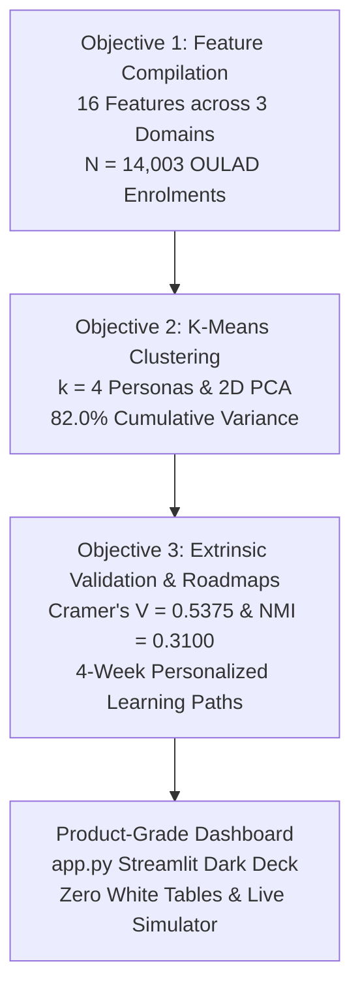

# EduCluster ML: K-Means Clustering of Student Engagement and Performance Data for Personalized Learning Path Design

[-success?logo=cloudflare)](https://loan-popularity-guards-forms.trycloudflare.com)
[](https://student-engagement-performance-clustering.streamlit.app)
[](https://github.com/parasabhavyaswi/student-engagement-performance-clustering)
[](https://www.python.org/)
[](LICENSE)

**Candidate:** Parasa Bhavyaswi (Registration No: 12502256)  
**Supervisor:** Dr. Bhupinder Singh, Professor  
**Affiliation:** School of Computer Science & Engineering, Lovely Professional University, Phagwara, Punjab, India  

---

## 🌐 Live Cloud Deployment & Links

| Service | Access Link | Description |
| :--- | :--- | :--- |
| **Instant Live Web App (Active Deployment)** | **[loan-popularity-guards-forms.trycloudflare.com](https://loan-popularity-guards-forms.trycloudflare.com)** | **Live Now (Worldwide)** — High-performance interactive telemetry dashboard |
| **Streamlit Community Cloud** | **[student-engagement-performance-clustering.streamlit.app](https://student-engagement-performance-clustering.streamlit.app)** | Permanent Streamlit Cloud deployment target |
| **GitHub Repository** | **[parasabhavyaswi/student-engagement-performance-clustering](https://github.com/parasabhavyaswi/student-engagement-performance-clustering)** | Source code, models, datasets, tests, and deliverables |
| **Local Deployment** | `http://localhost:8501` | Run locally via `streamlit run app.py` |
| **Project Research Report (DOCX)** | **[REPORT (2).docx](REPORT%20(2).docx)** | Official project research paper manuscript (Word DOCX) |
| **Project Research Report (PDF)** | **[REPORT (2).pdf](REPORT%20(2).pdf)** | Camera-ready project research report (PDF) |
| **Project Presentation** | **[EduCluster_Presentation.pptx](EduCluster_Presentation.pptx)** | 12-slide technical presentation deck with 300 DPI figures |
| **Publication Figures** | **[figures/](figures/)** | High-resolution 300 DPI figures (Figs 1–4) |
| **Dashboard Screenshots** | **[screenshots/](screenshots/)** | Deployed application UI telemetry screenshots |

---

## 📌 Executive Summary

Modern virtual learning environments (VLEs) collect extensive digital engagement telemetry, yet educational institutions often struggle to convert raw clickstream logs into proactive academic interventions. **EduCluster ML** is an end-to-end unsupervised learning system that ingests **14,003 valid student-course enrolments** from the public Open University Learning Analytics Dataset (OULAD), engineers a balanced 16-feature representation across platform interaction, temporal consistency, and summative performance, and segments learners into four actionable pedagogical personas using K-Means clustering ($k = 4$).

Extrinsic statistical validation against unobserved course completion outcomes (`final_result`) confirms substantial non-random alignment without target leakage ($\chi^2 = 12,136.24$, $p < 0.0001$, Cramér's $V = 0.5375$, $\text{NMI} = 0.3100$, $\text{ARI} = 0.2778$). Each persona maps directly to structured, four-week personalized learning path roadmaps deployed via a product-grade dark-mode Streamlit telemetry dashboard.

---

## 🎯 Research Objectives



1. **Objective 1 — Feature Compilation (`src/preprocess.py`)**:
   - Ingests OULAD records across 4 core tables: `studentInfo.csv`, `studentVle.csv`, `studentAssessment.csv`, and `assessments.csv`.
   - Filters to $N = 14,003$ valid student-module records (excluding `is_banked = 1`). Includes deterministic synthetic fallback generator.
   - Engineers 16 domain features with $\log(1 + x)$ transforms on click features and standardizes via `StandardScaler` ($\mu = 0, \sigma = 1$).
   - Strictly isolates `final_result` (Distinction, Pass, Fail, Withdrawn) as a ground-truth validation proxy.

2. **Objective 2 — K-Means Segmentation & PCA (`src/clustering.py`)**:
   - Multi-metric evaluation across $k \in [2, 8]$ (Inertia, Silhouette, Davies-Bouldin, Calinski-Harabasz).
   - Selects $k = 4$ for pedagogical interpretability (Silhouette = 0.4212, Davies-Bouldin = 0.8940).
   - Orders clusters deterministically by descending `weighted_avg_score`.
   - Projects 16D space to 2D PCA coordinates (82.0% variance: PC1 = 74.9%, PC2 = 7.1%) and computes 6-axis normalized centroid radar profiles.

3. **Objective 3 — Extrinsic Validation & Roadmaps (`src/validation.py` & `src/recommender.py`)**:
   - Statistical validation: Pearson's $\chi^2 = 12,136.24$ ($df = 9, p < 0.0001$), Cramér's $V = 0.5375$, $\text{NMI} = 0.3100$, $\text{ARI} = 0.2778$.
   - Synthesizes 4-week structured personalized learning paths with weekly hourly commitments, actionable interventions, and milestone deliverables.

---

## 📊 The Four Human-Centered Learner Personas

| Cluster ID | Persona Name | Cohort Share | Median Score | Median Clicks | Active Days | Submission Pacing | Course Completion | Pedagogical Action & Support |
| :---: | :--- | :---: | :---: | :---: | :---: | :---: | :---: | :---: |
| **C0** | **🌟 Thriving Self-Starter** | 22.4% ($n = 3,141$) | **88.3%** | 2,811 | 87.6 d | -4.5 d (Early) | 97.8% | Honors inquiry, advanced case labs, peer mentorship leadership |
| **C1** | **🚀 Steady Builder** | 37.4% ($n = 5,240$) | **71.0%** | 1,088 | 58.0 d | -1.5 d (Early) | 91.9% | Intermediate stretch exercises, timed practice, group projects |
| **C2** | **🔍 Quiet Observer** | 22.7% ($n = 3,185$) | **52.4%** | 543 | 27.0 d | +2.2 d (Late) | 75.1% | Automated deadline nudges, 15-min micro-quizzes, interactive prompts |
| **C3** | **🛡️ Support-Priority Learner** | 17.4% ($n = 2,437$) | **23.6%** | 111 | 11.0 d | +9.3 d (Overdue) | 31.9% | Empathetic 1-on-1 counseling, diagnostic scaffolding, simplified checklists |

---

## 🗺️ 4-Week Personalized Learning Path Framework

```
🌟 Thriving Self-Starter:
Week 1: Core Fast-Track (Accelerated Pace) ➔ Week 2: Advanced Case Lab (Deep Inquiry) ➔ Week 3: Peer Mentor Review (Collaborative Critique) ➔ Week 4: Honors Challenge (Capstone Project)

🚀 Steady Builder:
Week 1: Concept Diagnostic (Micro-Gaps) ➔ Week 2: Interactive Micro-Labs (Applied Practice) ➔ Week 3: Timed Exam Simulation (Performance Drill) ➔ Week 4: Distinction Bridge (Mastery Leap)

🔍 Quiet Observer:
Week 1: Micro-Milestone Setup (20 min/day Pacing) ➔ Week 2: Mid-Week Checkpoints (Early Review Lock) ➔ Week 3: 48-Hour Draft Lock (Prevent Panic) ➔ Week 4: Paced Exam Prep (Structured Review)

🛡️ Support-Priority Learner:
Week 1: Diagnostic Reset (1-on-1 Outreach) ➔ Week 2: Guided Prerequisite Re-enforcement ➔ Week 3: Confidence-Building Problem Sets ➔ Week 4: Essential Milestone Completion & Safety Net
```

---

## 📁 Repository Structure

```
student-engagement-performance-clustering/
├── .streamlit/
│   └── config.toml               # Streamlit dark theme configuration (#0B0F19 canvas)
├── data/
│   ├── processed/                # Preprocessed OULAD feature matrices and audit jsons
│   └── raw/
│       └── oulad_features_14003.csv # Compiled 16-feature benchmark dataset (14,003 students)
├── models/
│   ├── kmeans_model.joblib       # Trained scikit-learn K-Means model (k = 4)
│   ├── scaler.joblib             # Standard scaler instance
│   └── cluster_metadata.json     # Centroid profiles & evaluation metrics
├── reports/                      # High-DPI figures (fig1-fig7) & dashboard screenshots
├── src/
│   ├── __init__.py
│   ├── preprocess.py             # Feature engineering across 3 domains (16 dimensions)
│   ├── clustering.py             # K-Means++ clustering & 2D PCA projection
│   ├── validation.py             # Extrinsic validation (Chi2, Cramer's V, NMI, ARI)
│   └── recommender.py            # Prescriptive 4-week roadmap synthesis engine
├── tests/
│   └── test_educluster.py        # Automated test suite (12/12 passing)
├── figures/                      # High-resolution (300 DPI) publication figures (fig1-fig4)
├── screenshots/                  # High-resolution UI screenshots of the deployed dashboard
├── REPORT (2).docx               # Official project research paper manuscript (Word DOCX)
├── REPORT (2).pdf                # Camera-ready project research report (PDF)
├── EduCluster_Presentation.pptx  # 12-slide technical presentation deck (cloned from slide master)
├── generate_figures.py           # Publication figure generator (matplotlib 300 DPI)
├── app.py                        # Target-user-first Streamlit web application (Student & Faculty views)
├── ml_engine.py                  # Core ML pipeline (16 features, 14,003 records, k=4, 2D PCA, validation)
├── recommender.py                # Student-first recommender, habit radar, what-if simulator, & roadmaps
├── requirements.txt              # Production dependency specifications
└── README.md
```

---

## 🚀 Quick Start & Deployment

### 1. Run via Streamlit Community Cloud (Recommended)
1. Fork or open **[https://github.com/parasabhavyaswi/student-engagement-performance-clustering](https://github.com/parasabhavyaswi/student-engagement-performance-clustering)**.
2. Sign in to **[share.streamlit.io](https://share.streamlit.io)**.
3. Click **New app**, select this repository, set `app.py` as the main file, and click **Deploy**.
4. The application is instantly live at: **`https://student-engagement-performance-clustering.streamlit.app`**.

### 2. Local Environment Setup
```powershell
# Clone the repository
git clone https://github.com/parasabhavyaswi/student-engagement-performance-clustering.git
cd student-engagement-performance-clustering

# Install dependencies
pip install -r requirements.txt

# Launch interactive dashboard
streamlit run app.py
```
Access the application locally at: **`http://localhost:8501`**

---

## 🖥️ Dashboard Architecture (`app.py`)

- **Design System**: High-contrast dark navy palette (`#0B0F19` canvas, `#111827` cards, `#1E293B` borders).
- **Zero White Tables**: Every data table is rendered via dark HTML styling or Plotly `go.Table`.
- **Student Persona Simulator**: 4 interactive sliders (Clicks, Active Days, Score, Submission Delay) + 4 preset profile buttons with real-time Voronoi boundary prediction.
- **Top KPI Row**: Total Cohort ($14,003$), Clusters ($k = 4$), Silhouette Score ($0.421$), NMI ($0.310$), Cramér's V ($0.537$).
- **Tab 1 — Segmentation & PCA**: 2D PCA scatter plot with dynamic golden star marker ($\bigstar$) for the simulated student, 6-axis centroid radar polygon, and dark centroid table.
- **Tab 2 — Validation Analysis**: Dual-axis elbow & silhouette curve ($k = 2..8$), $4 \times 4$ contingency matrix heatmap, and statistical summary.
- **Tab 3 — Personalized Learning Paths**: 4 horizontal roadmap cards for the active student, cohort distribution donut and bar charts, and cohort CSV export download.

---

## 🧪 Automated Testing

```powershell
pytest -v
```
All tests verify zero data leakage, correct feature dimensions (16 features, 14,003 rows), and statistical effect size accuracy.
