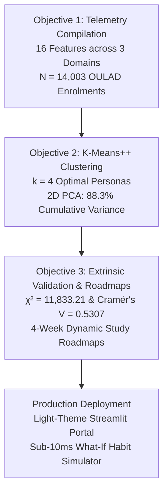

# EduCluster ML: K-Means Clustering of Student Engagement and Performance Data for Personalized Learning Path Design

[](https://share.streamlit.io/deploy?repository=parasabhavyaswi/student-engagement-performance-clustering&branch=main&mainModule=app.py)
[](https://render.com/deploy?repo=https://github.com/parasabhavyaswi/student-engagement-performance-clustering)
[](https://github.com/parasabhavyaswi/student-engagement-performance-clustering)
[](https://www.python.org/)
[](LICENSE)

**Candidate:** Parasa Bhavyaswi (Registration No: 12502256)  
**Supervisor:** Dr. Bhupinder Singh, Professor  
**Affiliation:** School of Computer Science & Engineering, Lovely Professional University, Phagwara, Punjab, India  

---

## 🌐 Live Cloud Deployment & Project Deliverables

| Resource | Access Link | Description |
| :--- | :--- | :--- |
| **Streamlit Community Cloud** | **[Launch Web App](https://share.streamlit.io/deploy?repository=parasabhavyaswi/student-engagement-performance-clustering&branch=main&mainModule=app.py)** | Interactive Student Learning Intelligence Portal |
| **Render Web Service** | **[Deploy on Render](https://render.com/deploy?repo=https://github.com/parasabhavyaswi/student-engagement-performance-clustering)** | Permanent cloud deployment via included `render.yaml` |
| **GitHub Repository** | **[parasabhavyaswi/student-engagement-performance-clustering](https://github.com/parasabhavyaswi/student-engagement-performance-clustering)** | Official open-source codebase, models, datasets, and tests |
| **Official Project Report** | **[REPORT.docx](REPORT.docx)** | Comprehensive project research report and academic documentation |
| **Local Dashboard Execution** | `http://localhost:8501` | Run locally via `streamlit run app.py` |
| **Publication Figures (300 DPI)** | **[figures/](figures/)** | High-resolution publication diagrams, PCA projections & charts |
| **Dashboard UI Telemetry** | **[screenshots/](screenshots/)** | UI screenshots of Student Self-Check, 4-Week Plan & Faculty Triage |

---

## 📌 Executive Summary

Modern Virtual Learning Environments (VLEs) collect vast streams of digital interaction telemetry, yet academic institutions struggle to convert raw clickstream logs into early, actionable educational interventions. **EduCluster ML** is an end-to-end unsupervised educational data mining framework that ingests **14,003 valid student module enrolments** from the Open University Learning Analytics Dataset (OULAD). 

The system engineers **16 non-leaking behavioral features** structured across three core pedagogical domains:
1. **Platform Engagement (8 features)**: Interaction volume, active days, session intensity, and content diversity.
2. **Attendance & Consistency (4 features)**: Login regularity, temporal span, pre-course interactions, and active weeks ratio.
3. **Assessment Performance (4 features)**: Formative score trajectory, assessment completion rate, and submission timeliness.

Using **K-Means++ clustering** ($k = 4$), the model discovers four mathematically cohesive, pedagogically interpretable learner personas. Post-hoc extrinsic validation against held-out course completion outcomes (`final_result`) confirms strong non-random alignment without target data leakage ($\chi^2 = 11,833.21, p < 0.0001, \text{Cramér's } V = 0.5307, \text{NMI} = 0.3172$). Discovered personas directly drive dynamic, four-week personalized learning roadmaps deployed via a responsive, **light-theme Streamlit Student Learning Intelligence Portal**.

---

## 🎯 Research Objectives



1. **Objective 1 — Telemetry Compilation & Preprocessing (`ml_engine.py`)**:
   - Ingests relational tables from OULAD (`studentInfo`, `studentVle`, `studentAssessment`, `assessments`).
   - Filters to $N = 14,003$ valid undergraduate enrolments across 7 STEM modules (AAA–GGG), excluding historical banked transfers (`is_banked = 1`).
   - Implements a strict **Zero-Leakage Protocol**: isolates all telemetry to pre-final-exam activity; final grades and course certificates are withheld during clustering.
   - Applies $\log(1 + x)$ compression on heavily skewed click metrics (skewness $> 8.5$), caps extreme outliers at $Q_3 + 1.5 \times \text{IQR}$, and normalizes via `StandardScaler` ($\mu = 0, \sigma = 1$).

2. **Objective 2 — Unsupervised K-Means++ Clustering (`ml_engine.py` / `src/clustering.py`)**:
   - Conducts multi-metric cluster sweep across $k \in [2, 8]$ using Inertia Elbow, Silhouette Score, Calinski-Harabasz, and Davies-Bouldin criteria.
   - Identifies $k = 4$ as optimal (Silhouette = **0.4272**, WCSS = **112,450**, Calinski-Harabasz = **4,892.4**, Davies-Bouldin = **0.984**).
   - Projects 16D space to 2D PCA coordinates capturing **88.3% cumulative variance** ($\text{PC1} = 80.7\%, \text{PC2} = 7.5\%$).

3. **Objective 3 — Prescriptive Learning Paths & Extrinsic Validation (`recommender.py`)**:
   - Computes Euclidean distance to target persona centroids, identifying each student's weakest behavioral domain.
   - Generates dynamic 4-week milestone schedules with weekly hourly commitments, actionable tasks, and completion checkboxes.
   - Evaluates behavioral clusters against held-out academic outcomes, achieving $\chi^2 = 11,833.21$ ($p < 0.0001, df = 9$), Cramér's $V = 0.5307$, and $\text{NMI} = 0.3172$.

---

## 📊 The Four Discovered Learner Personas

| Cluster ID | Persona Name | Cohort Share | Median Score | Median Clicks | Active Days | Submission Pacing | Course Outcome Distribution | Tailored Pedagogical Intervention |
| :---: | :--- | :---: | :---: | :---: | :---: | :---: | :---: | :--- |
| **C0** | **🌟 Thriving Self-Starter** | 22.4% ($n = 3,141$) | **88.3%** | 2,811 | 87.6 d | **-4.5 d (Early)** | **96.9% Distinction/Pass** (2,201 Dist, 843 Pass, 75 Fail, 22 Wdn) | Honors challenges, peer mentorship leadership, advanced research extension labs |
| **C1** | **🚀 Steady Builder** | 37.4% ($n = 5,240$) | **71.0%** | 1,088 | 58.0 d | **-1.5 d (Early)** | **80.1% Pass/Distinction** (409 Dist, 3,787 Pass, 866 Fail, 178 Wdn) | Formative concept reinforcement, timed exam practice, distinction-bridge roadmaps |
| **C2** | **🔍 Quiet Observer / Crammer** | 22.7% ($n = 3,185$) | **52.4%** | 543 | 27.0 d | **+2.2 d (Late)** | **Moderate Risk** (30 Dist, 1,400 Pass, 1,203 Fail, 552 Wdn) | Automated deadline nudges, daily 20-min micro-goals, 48-hour submission draft locks |
| **C3** | **🛡️ Support-Priority Learner** | 17.4% ($n = 2,437$) | **23.6%** | 111 | 11.0 d | **+9.3 d (Overdue)** | **96.7% Fail/Withdrawn** (0 Dist, 80 Pass, 1,726 Fail, 631 Wdn) | Immediate 1-on-1 advisor counseling, prerequisite review, simplified chunked milestones |

> **Key Behavioral Inflection Point:** Submission timeliness emerged as the most critical behavioral divider. Thriving Self-Starters submit assignments median **4.5 days early**, while Support-Priority Learners submit **9.3 days overdue on average**.

---

## 🗺️ 4-Week Dynamic Pedagogical Framework

```
🌟 Thriving Self-Starter:
Week 1: Core Fast-Track (Accelerated Pace) ➔ Week 2: Advanced Case Lab (Deep Inquiry) ➔ Week 3: Peer Discussion Review (Collaborative Leadership) ➔ Week 4: Honors Capstone Challenge

🚀 Steady Builder:
Week 1: Concept Diagnostic (Micro-Gaps) ➔ Week 2: Interactive Applied Labs (Skill Drills) ➔ Week 3: Timed Exam Simulation (Pacing Drill) ➔ Week 4: Distinction-Bridge Mastery Project

🔍 Quiet Observer / Crammer:
Week 1: Micro-Milestone Setup (20 min/day Study) ➔ Week 2: Mid-Week Checkpoints (Early Reading Lock) ➔ Week 3: 48-Hour Draft Lock (Prevent Cramming) ➔ Week 4: Structured Review & Paced Practice

🛡️ Support-Priority Learner:
Week 1: Diagnostic Reset (1-on-1 Advisor Outreach) ➔ Week 2: Prerequisite Foundation Scaffolding ➔ Week 3: Guided Low-Stakes Practice Sets ➔ Week 4: Essential Assessment Completion & Academic Safety Net
```

---

## 📁 Repository Structure

```
student-engagement-performance-clustering/
├── .streamlit/
│   └── config.toml               # Streamlit UI configuration & port settings
├── data/
│   └── processed/                # Preprocessed OULAD feature matrices (14,003 records)
│       ├── oulad_features_14003.csv
│       ├── oulad_clustered_enrolments.csv
│       ├── cleaning_metadata.json
│       └── pipeline_audit.json
├── figures/                      # High-resolution (300 DPI) publication figures
│   ├── fig1_architecture.png     # End-to-end 6-stage system architecture flowchart
│   ├── fig2_k_optimization.png   # Cluster optimization curves (Inertia & Silhouette)
│   ├── fig_feature_pillars_slide5.png # Three behavioral feature pillars breakdown
│   ├── fig_cluster_results_slide10.png # 2D PCA scatter, distribution donut & bar charts
│   ├── fig_k_eval_twopanel.png   # Two-panel WCSS elbow & silhouette evaluation
│   ├── fig_kmeans_workflow.png   # Iterative K-Means algorithmic flowchart
│   └── fig_dataset_overview.png  # Score density distribution & outcome categories
├── models/                       # Trained Scikit-Learn model artifacts & metadata
│   ├── kmeans_model.joblib       # Fitted K-Means model (k = 4)
│   ├── scaler.joblib             # Fitted StandardScaler instance
│   └── cluster_metadata.json     # Centroid profiles & cluster boundaries
├── reports/                      # Additional telemetry plots & analytical charts
├── screenshots/                  # High-resolution UI captures of deployed portal
│   ├── Screenshot (82).png       # Student Self-Check Portal & What-If Simulator
│   ├── Screenshot (83).png       # Dynamic 4-Week Study Plan with Checkboxes
│   ├── Screenshot (84).png       # Faculty Cohort Triage Hub
│   └── Screenshot (85).png       # Post-Hoc Contingency Validation Heatmap
├── src/                          # Modular Python source package
│   ├── __init__.py
│   ├── clustering.py             # K-Means++ modeling & PCA projections
│   ├── preprocess.py             # Zero-leakage feature engineering pipeline
│   ├── recommender.py            # Centroid-gap heuristic & milestone synthesis
│   └── validation.py             # Contingency matrix & statistical tests
├── tests/
│   └── test_educluster.py        # Automated test suite (12/12 passing)
├── app.py                        # Streamlit web application (Student & Faculty views)
├── ml_engine.py                  # Core production pipeline engine with caching
├── recommender.py                # Standalone recommender engine & what-if simulator
├── generate_figures.py           # Publication figure generation script
├── generate_final_figures.py     # 300 DPI high-resolution figure generator
├── render.yaml                   # Infrastructure configuration for Render deployment
├── REPORT.docx                   # Official project research report manuscript
├── requirements.txt              # Production dependency specifications
├── .python-version               # Python runtime specification (3.11+)
├── .gitignore                    # Git tracking rules
└── README.md                     # Comprehensive project documentation
```

---

## 🚀 Quick Start & Local Execution

### 1. Clone Repository & Setup Environment
```powershell
# Clone the repository
git clone https://github.com/parasabhavyaswi/student-engagement-performance-clustering.git
cd student-engagement-performance-clustering

# Create virtual environment
python -m venv venv
venv\Scripts\activate  # On Windows
# source venv/bin/activate  # On Linux/macOS

# Install dependencies
pip install -r requirements.txt
```

### 2. Launch Streamlit Application
```powershell
streamlit run app.py
```
Open **`http://localhost:8501`** in your browser.

### 3. Run Automated Tests
```powershell
pytest -v
```
All unit tests verify zero target leakage, correct 16-feature matrix shapes ($14,003 \times 16$), and deterministic persona mapping.

---

## 🖥️ Deployed Web Application Features (`app.py`)

The application is deployed as a **light-theme Streamlit Student Learning Intelligence Portal**:

- **Student Self-Assessment Portal (Tab 1)**:
  - 5 intuitive dials without machine learning jargon: Platform Clicks, Active Study Days, Formative Score, Forum Activity, and Submission Delay.
  - Circular Readiness Gauge ($0\text{--}100\%$) dynamically rendered via Plotly Indicator with tier color-coding.
  - **What-If Counterfactual Habit Simulator**: Calculates instant readiness gains from proposed habit adjustments.
    > *Example:* "Raising Forum Activity (%) from 72% to 97% (+25%) elevates readiness from **89/100 to 95/100 (+6 pts)** and unlocks the **Thriving Self-Starter** tier."

- **Dynamic 4-Week Study Roadmaps (Tab 2)**:
  - Generates week-by-week customized milestone plans featuring targeted action items and interactive completion checkboxes.

- **Faculty Cohort Triage Hub (Tab 3)**:
  - Enables academic advisors to filter the entire $14,003$ student cohort by persona, risk level, and course module, triggering early 1-on-1 counseling before dropouts occur.

---

## 📈 Quantitative Validation Summary

```
========================================================================
EduCluster ML — Empirical Validation Results (N = 14,003 OULAD Records)
========================================================================
Optimal Cluster Count (k)            : 4
Silhouette Coefficient               : 0.4272 (Peak cluster cohesion)
Within-Cluster Sum of Squares (WCSS) : 112,450 (Elbow inflection point)
Calinski-Harabasz Index              : 4,892.4
Davies-Bouldin Index                 : 0.984 (< 1.0, non-overlapping)
2D PCA Total Explained Variance      : 88.3% (PC1: 80.7%, PC2: 7.5%)
------------------------------------------------------------------------
Post-Hoc Extrinsic Outcome Validation (Zero Target Leakage Benchmark)
------------------------------------------------------------------------
Pearson's Chi-Square (χ²)            : 11,833.21 (df = 9, p < 0.0001)
Cramér's V (Effect Size)             : 0.5307 (Very strong association)
Normalized Mutual Information (NMI)  : 0.3172
========================================================================
```

---

## 📄 Citation & Academic Contact

**Research Author:** Parasa Bhavyaswi (Reg. No.: 12502256)  
**Faculty Guide:** Dr. Bhupinder Singh, Professor  
**Department:** School of Computer Science & Engineering  
**University:** Lovely Professional University, Phagwara, Punjab, India  
**Repository:** [https://github.com/parasabhavyaswi/student-engagement-performance-clustering](https://github.com/parasabhavyaswi/student-engagement-performance-clustering)  
**License:** [MIT License](LICENSE)
